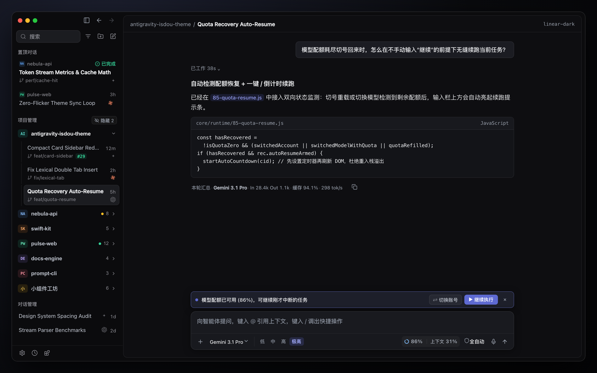
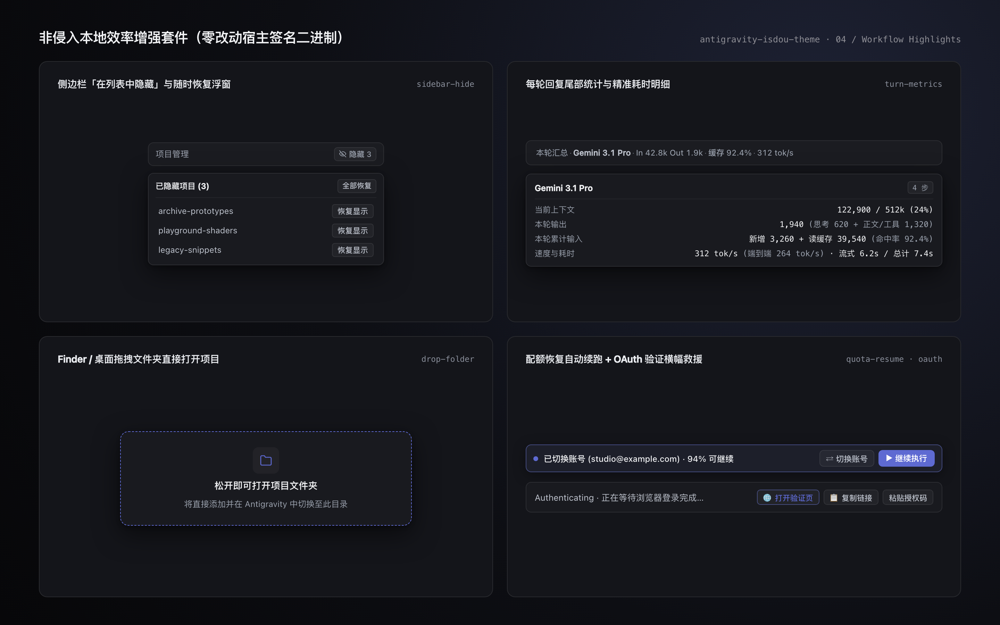
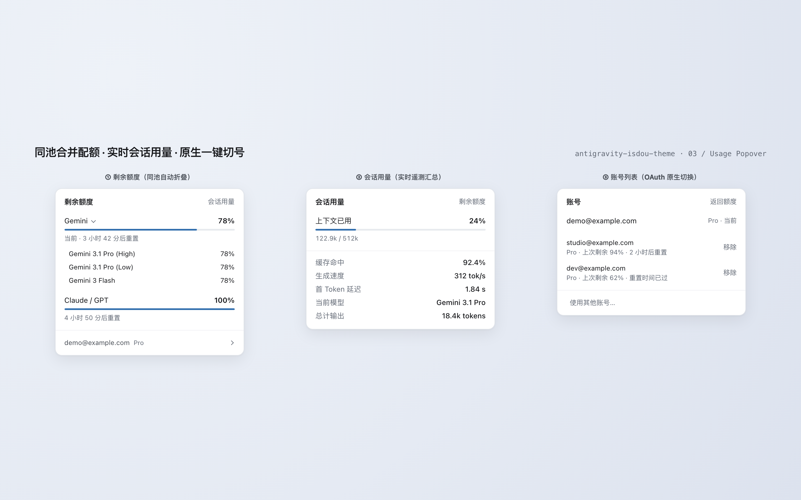
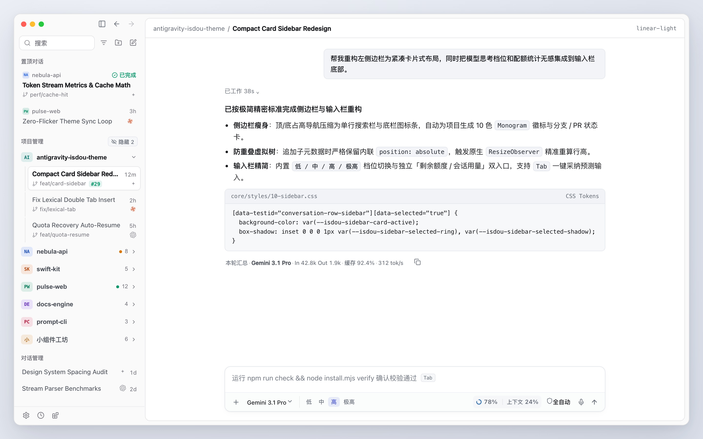

# antigravity-isdou-theme

面向 **Google Antigravity** 的 **Linear 极简克制风格** 界面重构主题、中文界面本地化与原生工作流效率增强套件。

基于本地 Chrome DevTools Protocol（CDP）守护进程实时注入样式与运行时脚本，**不修改已签名的 `.app` 主程序二进制与服务端文件**，可随时完整停用或卸载还原。

> 环境要求：Node.js `>= 22.13.0`

---

## 效果预览

> **深色工作区（`linear-dark`）与配额恢复自动续跑条**：卡片侧边栏、每轮回复统计，以及配额可用时自动亮起的续跑提示条


> **高频工作流增强套件**：侧栏隐藏项目与一键恢复、每轮耗时与缓存拆解、Finder 拖拽文件夹直开项目、OAuth 验证横幅救援


> **额度 / 会话 / 多账号三合一浮窗**：同池模型自动合并折叠、实时会话遥测，以及切号前的上次剩余额度预览


> **浅色工作区（`linear-light`）**：极简发丝边线、项目 Monogram 徽标、内联思考强度切换与 `Tab` 预测输入


---

## 核心功能

### 1. Linear 极简视觉与输入栏重构
- 提供 `linear-light`（默认）与 `linear-dark` 双预设色阶，统一 6px 几何圆角、1px 发丝边线、对话气泡与设置/命令面板（`⌘K`）样式。
- **输入栏响应式改造**：支持主对话区与右侧 `Side Question` 双窗格；自动去掉模型名称中重复的 `Gemini ` 前缀，并在输入栏中内嵌思考强度调节器（`低` / `中` / `高` / `极高`，窄屏下自动折叠为紧凑切换胶囊）及模型配额进度显示。

### 2. 侧边栏项目管理「在列表中隐藏」
- 在左侧「项目管理」每个文件夹行的 `...` 菜单「删除项目」前新增 **「在列表中隐藏」** 选项。
- 仅作本地视图过滤（记录于 `localStorage`），**不删除项目文件、不修改服务端项目状态**，并复用原生虚拟列表重排，隐藏后无空白占位间隙，也不会把该项目下对话错归入孤立对话列表。
- 有项目被隐藏时，「项目管理」标题右侧会显示紧凑的 **「隐藏 N」** 按钮，点击浮窗支持单个 **「恢复显示」** 或 **「全部恢复」**；将已隐藏的文件夹从桌面重新拖入打开时也会自动取消隐藏。

### 3. 桌面 / Finder 拖拽文件夹直接打开
- 从 Finder 或桌面将本地文件夹拖入 Antigravity 窗口任意位置即可直接打开或切换聚焦对应项目，省去手动点选层级目录的弹窗步骤。
- 普通文件或图片拖入输入框时，仍保持 Antigravity 原生附件上传逻辑，互不干扰。

### 4. 原生一键切换账号与验证辅助横幅
- 面向拥有多个合法会员账号的场景，在顶部状态区 / 账号切换入口复用 Antigravity 内置 OAuth 登录流程（`authService.loginWithRedirect`），并在 `localStorage` 保存非敏感的邮箱与最近配额快照（**不接触系统 Keychain 或任何凭据 Token**）。
- 当浏览器关闭或跳转阻塞停留在 `Authenticating...` 横幅时，横幅内提供 **「🌐 打开验证页」「📋 复制链接」「粘贴授权码 / 提交」「取消验证」**，避免死等卡住。

### 5. 配额耗尽 / 切号后无缝续跑条
- 记录因模型配额耗尽而中断的会话上下文，在切换账号或更换到有可用配额的模型后，输入框上方自动出现高亮续跑条（支持手点继续或开启“配额恢复后自动继续”）。

### 6. 实时会话遥测、提示词预测与稳定性增强
- **实时会话遥测**：底部状态胶囊（输出速率 `tok/s`、上下文占比 `Ctx`、缓存命中率 `Cache`）、悬停面板与每轮回复尾部耗时/用量统计。
- **Claude Code 风格提示词预测**：输入框浅灰 ghost text + `Tab` / `→` 采纳下一句建议。
- **中文界面本地化**：基于 `WeakMap` 隔离与排除列表的安全 DOM 本地化引擎，不误伤代码块、用户输入与对话内容。
- **稳定性护卫**：TanStack Router 设置弹窗 URL 死锁自愈、跨平台缩放快捷键。

---

## 模块与目录结构

### 样式分层（`core/styles/`）
- [00-tokens.css](core/styles/00-tokens.css) — Linear 昼夜色阶（Daylight / Obsidian）、6px 精密几何圆角、字重与边线变量
- [10-sidebar.css](core/styles/10-sidebar.css) — Linear 极简侧边栏、项目树引导线、隐形滚动条与隐藏项目徽章/浮窗样式
- [15-topbar.css](core/styles/15-topbar.css) — Linear 正交顶栏、面包屑与面板切换图标
- [20-chat.css](core/styles/20-chat.css) — 主对话气泡、Markdown 排版、代码块与工具调用活动时间轴
- [30-composer.css](core/styles/30-composer.css) — 底部输入框、属性芯片、思考强度切换、配额徽章、实时遥测胶囊与幽灵补全样式
- [40-modals-home.css](core/styles/40-modals-home.css) — 系统设置弹窗、账号验证操作栏、命令面板（`⌘K`）与首页欢迎页

### 运行时模块（`core/runtime/`）
- [00-head.js](core/runtime/00-head.js) — 引导初始化、生命周期清理钩子、i18n 排除选择器与样式注入
- [10-guards.js](core/runtime/10-guards.js) — 设置弹窗路由死锁修复与跨平台缩放快捷键
- [20-theme-sync.js](core/runtime/20-theme-sync.js) — 昼夜主题与设计变量实时同步
- [30-antigravity-probe.js](core/runtime/30-antigravity-probe.js) / [40-status-machine.js](core/runtime/40-status-machine.js) / [50-telemetry-ui.js](core/runtime/50-telemetry-ui.js) — 会话状态探测与遥测面板渲染
- [55-project-hider.js](core/runtime/55-project-hider.js) — 侧边栏文件夹「在列表中隐藏」与「隐藏 N」恢复浮窗
- [60-i18n-engine.js](core/runtime/60-i18n-engine.js) — 中文界面本地化引擎（词典见 [core/i18n.json](core/i18n.json)）
- [62-account-switcher.js](core/runtime/62-account-switcher.js) — 原生一键切号、验证横幅辅助与配额快照
- [65-composer-bar.js](core/runtime/65-composer-bar.js) — 输入栏响应式改造（精简模型名、内嵌思考强度与配额条）
- [70-prompt-suggestions.js](core/runtime/70-prompt-suggestions.js) — `Tab` / `→` 下一句预测补全
- [80-folder-drop.js](core/runtime/80-folder-drop.js) — 桌面/Finder 文件夹拖入打开与聚焦
- [85-quota-resume.js](core/runtime/85-quota-resume.js) — 配额耗尽/切号后续跑条
- [90-tail.js](core/runtime/90-tail.js) — 自定义扩展加载与运行时收尾

---

## 安装、按需开关与日常命令

### 收到安装包后

解压 ZIP，在包含 `install.mjs` 的目录打开终端。首次安装时，用下面的命令订阅正式版更新。

```bash
node install.mjs install --auto-update
```

后台服务启动约 15 秒后会尝试检查更新。自动检查每 6 小时最多一次，重启沿用上次记录。发布者只修改样式或中文文案时，已经打开的窗口会在下一次检查后热更新。自己的主题变量、自定义 CSS 和翻译覆盖继续生效。网络不可用时继续使用已安装的版本。

若新版包含运行脚本、后台服务或安装器变动，侧栏底部会出现「更新主题」（启用侧栏主题时）。打开项目的正式发行页，下载新版 ZIP，解压后再次运行同一条安装命令即可保留个人配置。旧版本用户需要先安装一次支持订阅的版本。

```bash
node install.mjs update --check     # 查询最新正式版
node install.mjs update             # 立即应用兼容的外观包，或显示整包升级地址
node install.mjs update --rollback  # 恢复上一个外观，跳过刚回退的版本
```

普通安装 `node install.mjs install` 首次默认关闭订阅。可在安装目录的 `user/config.json` 将 `autoUpdate` 设为 `false` 关闭后续自动检查。设置为 `true` 后，在下一次检查或后台服务重启时生效。开发工作树及使用源码软链的安装继续读取本地文件。

### 发布一个能同步的版本

发布者递增 `package.json` 的版本号，运行 `node install.mjs build-manifest`，将源码与清单一起提交。把与版本号一致的标签（例如 `v0.2.0`）推到仓库后，发布工作流会测试并将完整 ZIP、`theme-update.json` 一起附到正式 Release。日常推送 `main` 只更新源码。

本地可以用 `node install.mjs pack` 生成相同的两个文件。手动发布时，将两者上传到同一个正式 Release，并把它设为 Latest。ZIP 发给使用者，更新服务读取对应标签的外观资源并核对下载大小和 SHA-256。版本号每次递增。整包和每个版本的发布说明都在[项目发行页](https://github.com/isdou/antigravity-isdou-theme/releases)。

### 源码开发

```bash
# 1. 重新生成资源校验清单并运行语法校验
node install.mjs build-manifest
npm run check

# 2. 安装并启动后台守护注入服务
node install.mjs install

# 3. 诊断 / 验证实时注入状态
node --disable-warning=ExperimentalWarning install.mjs doctor
node --disable-warning=ExperimentalWarning install.mjs verify

# 4. 其它常用维护命令
node install.mjs relaunch [--channel auto|stable|insiders] [--force]
node install.mjs rollback
node install.mjs uninstall
```

### 按特征组筛选安装（`--only` / `--without`）

安装器支持按功能组裁剪（`theme`、`i18n`、`metrics`、`fixes`），例如只需极简主题而不启用任何交互修补或切号增强：

```bash
node install.mjs install --preset linear-light --only theme
# 或跳过修复与交互增强组（deadlockHealer / zoomShortcuts / projectHider / accountSwitcher / folderDrop / quotaResume）
node install.mjs install --without fixes
# 可切换深色预设
node install.mjs install --preset linear-dark
```

### 细粒度单模块开关（`user/config.json`）

在用户配置文件的 `modules` 字段中可单独启用/禁用任意子模块（设为 `false` 即可关闭，修改后同步并验证即生效）：

```json
{
  "enabled": true,
  "channel": "auto",
  "preset": "linear-light",
  "modules": {
    "theme": true,
    "i18n": true,
    "metrics": true,
    "promptSuggestions": true,
    "projectHider": true,
    "accountSwitcher": true,
    "folderDrop": true,
    "quotaResume": true,
    "deadlockHealer": true,
    "zoomShortcuts": true,
    "cdpAutoRelaunch": true,
    "customCss": true,
    "customJs": true
  }
}
```

---

## 免责声明与使用边界

1. **非官方第三方开源项目**：本项目仅用于个人界面美观优化与本地效率增强，与 Google、Google DeepMind 或 Antigravity 官方无任何隶属、授权、背书或合作关系；软件按 **“现状”（AS IS）** 提供，使用过程产生的任何风险与后果由使用者自行承担。
2. **非侵入式本地注入说明**：本工具通过本地 CDP 调试端口在渲染层热注入样式与前端脚本，不修改主程序签名文件或服务端代码；如遇官方版本大改导致部分选择器或内部状态失效，可通过 `node install.mjs rollback` 或 `node install.mjs uninstall` 一键无损还原，或关闭对应模块开关。
3. **账号切换与服务条款（ToS）合规提醒**：
   - `accountSwitcher` 模块仅调起官方客户端内置 OAuth 认证界面并在浏览器 `localStorage` 中记录非敏感的展示快照（邮箱、套餐名与配额百分比），**不会读写系统 Keychain 凭据、不会截获或重放 OAuth Refresh Token，也绝不作为第三方反代接口**。
   - **请勿**将本工具与任何第三方反代/套壳 Agent、批量免费小号、共享/转售账号或无人值守高频自动化轮切脚本搭配使用；短时间内频繁跨号或高频切换异常网络节点仍可能触发平台反滥用风控。
   - 如因违反平台 Terms of Service（ToS）或异常使用习惯导致 Antigravity / Gemini CLI 等访问权限受限或被封禁，本项目及作者不承担任何责任；如无多账号需求，建议在配置中将 `"accountSwitcher": false` 关闭。

---

## 致谢与协议

底层 CDP 热重载注入与冷启动接力机制参考了社区 MIT 开源项目 [Anarcadia/chuanban-antigravity-theme-patch](https://github.com/Anarcadia/chuanban-antigravity-theme-patch) 与 [nkjDSLcvanv/antigravity-codex-theme](https://github.com/nkjDSLcvanv/antigravity-codex-theme)，视觉设计与交互增强模块独立重制。

基于 [MIT License](LICENSE) 开源。
